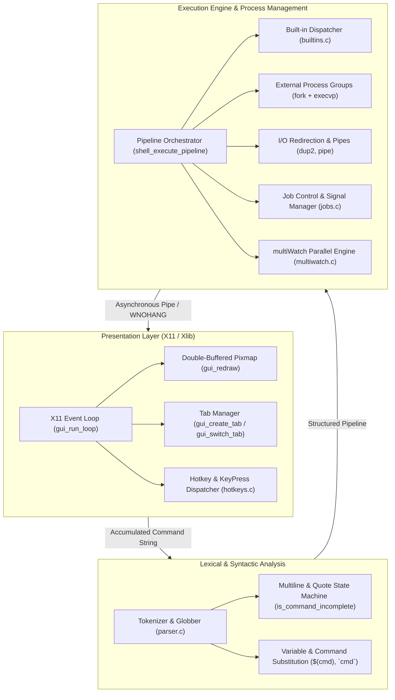

# Terminator: System Design & Architecture Document
**Computing Lab (CS69201) · Term Project · IIT Kharagpur**

---

## 1. Executive Summary & Project Architecture

**Terminator** is a full-featured, high-performance terminal emulator and Unix command shell developed in C for Linux. It combines an Xlib-based graphical user interface (GUI) supporting double-buffered rendering and tabbed workspaces with an advanced shell core supporting POSIX pipelines, I/O redirections, variable expansions, command substitutions, path globbing, job control, hotkey customization, and parallel command monitoring.

### 1.1 High-Level Architecture

Terminator is designed with a decoupled architecture separating the **Visual Presentation Layer (GUI)** from the **Execution Engine (Shell)**.



---

## 2. Dual Execution Modes

Terminator supports two distinct tab execution models per assignment specifications:

| Dimension | Thread Mode (Default: `./terminator`) | Process Mode (`./terminator useProcess=True`) |
| :--- | :--- | :--- |
| **Tab Isolation** | Tabs run as threads within the single application process. | The GUI runs in the parent; each tab forks a dedicated child process. |
| **Communication** | Direct in-memory structs and thread-safe queues. | Unidirectional UNIX IPC pipes connecting GUI to each tab process. |
| **CWD & Environment** | Isolated in per-tab `ShellContext` structures. | Naturally isolated by separate operating system process address spaces. |
| **Shared History** | Mutex/semaphore protected history ring buffer in process memory. | POSIX Shared Memory (`shm_open`, `mmap`) protected by a process-shared semaphore (`sem_open`). |
| **Fault Resilience** | Crash in a command handled by child `fork()`; main process protected. | Independent process failure cannot compromise sibling tabs or the GUI. |

---

## 3. Task-by-Task Implementation Architecture

### Task 1 — X11 GUI and Tabs
- **Xlib Double-Buffering**: All text drawing (`XDrawString`), tab bars, cursors, and backgrounds are rendered off-screen into a `Pixmap` back buffer (`app->back_buffer`) before being blitted to the visible `Window` via `XCopyArea`. This eliminates visual flicker during rapid typing or high-frequency command output.
- **Event Multiplexing**: The GUI event loop in `gui_run_loop` multiplexes X11 events (`XPending`) with non-blocking pipe I/O from active foreground and background processes using `select()` with a 10ms timeout.
- **Tab Geometry & Docked Button**: The tab bar reserves `TAB_BAR_HEIGHT` (36px). It renders an anchored `[ + ]` button at the right edge and distributes available horizontal width evenly among open tabs. Long paths are truncated dynamically (e.g., `[ 1: ..tor_anti ]`).
- **Visual Line Wrapping (Option A)**: In `gui_redraw`, long typed inputs wrap onto continuation rows below the prompt using column calculations derived from `font_width`. Scrollback lines preserve their visual layout independently.
- **Buffer Management**: Each tab maintains a scrollback buffer of up to `MAX_BUFFER_LINES` (2000 lines). Oldest lines roll off via `memmove` when capacity is exceeded.

### Task 2 — Built-in and External Commands
- **Built-in Commands**: `cd`, `exit`, `clear`, `jobs`, `fg`, `bg`, and `multiWatch` are identified by `is_builtin_command` and executed directly in the shell context without spawning external processes.
- **External Commands**: Executed via `fork()` and `execvp()`. The child process sets up process groups (`setpgid`), redirects file descriptors, and terminates with `_exit()` on failure.
- **Exit Status `$?` Tracking**: The exit status or terminating signal of commands is captured via `WEXITSTATUS(status)` or `128 + WTERMSIG(status)` and stored in `ctx->last_exit_status`.

### Task 3 — Multiline Input, Quoting & Command Substitution
- **Continuation Detection**: `is_command_incomplete` implements a single-pass state machine tracking unescaped trailing backslashes (`\`), unclosed single quotes (`'`), unclosed double quotes (`"`), unclosed command substitutions (`$(...)` or `` `...` ``), and trailing pipeline separators (`|`). If incomplete, the prompt switches to continuation prompt `> `.
- **POSIX Quoting Rules**: Single quotes treat all characters literally without variable substitution. Double quotes preserve whitespace but allow `$VAR`, `$?`, and command substitutions.
- **Command Substitution Engine**: `execute_substitution` forks a child process executing the inner pipeline, captures stdout through a pipe, strips trailing newlines per POSIX specification, and substitutes the result into the argument token.

### Task 4 — I/O Redirection
- **Operators `<` and `>`**: `setup_redirections` intercepts `<` (input) and `>` (output).
- **File Descriptors**: Input files are opened with `O_RDONLY`; output files are opened with `O_WRONLY | O_CREAT | O_TRUNC` (mode `0644`).
- **Atomic Redirection**: File descriptors are duplicated to `STDIN_FILENO` and `STDOUT_FILENO` via `dup2()`, followed by immediate `close()` of the source descriptors.
- **Ambiguous Redirect Detection**: Wildcards in redirection targets matching zero or multiple files trigger syntax errors rather than corrupting file systems.

### Task 5 — Pipelines & Pathname Globbing
- **Arbitrary Pipelines ($N$ Commands, $N-1$ Pipes)**: `shell_execute_pipeline` creates an array of pipe file descriptors. In child $i$:
  - If $i > 0$, stdin is redirected to `pipe[i-1][0]`.
  - If $i < N - 1$, stdout is redirected to `pipe[i][1]`.
  - All unused pipe ends across all child processes are closed immediately to prevent file descriptor leaks or hung readers.
- **Process Group Isolation**: Every pipeline command is placed into a unified process group via `setpgid(pid, pgid)` to enable synchronized signal broadcasting.
- **Pathname Expansion (Globbing)**: Integrated into `flush_token` using POSIX `<glob.h>`. Unquoted wildcard tokens (`*`, `?`, `[...]`) and tildes (`~`) are resolved against the active filesystem in sorted order using `GLOB_NOCHECK | GLOB_TILDE`. Quoted patterns are left untouched.

### Task 6 — `multiWatch`
- **Syntax Parsing**: `parse_multiwatch_commands` extracts command strings from array syntax `["cmd1", "cmd2", ...]` or comma-delimited argument lists.
- **Concurrent Monitoring**: Spawns all watched commands concurrently in child processes, each connected via dedicated non-blocking UNIX pipes.
- **Periodic 2-Second Timer**: Utilizes a monotonic timing loop (`clock_gettime(CLOCK_MONOTONIC)`) refreshing command outputs every 2.0 seconds.
- **Timestamped Formatted Output**: Displays clear header banners with command name and UNIX timestamp, followed by command output.
- **Graceful Termination**: Captures `SIGINT` (`Ctrl+C`) to terminate all active child process groups via `kill(-pgid, SIGTERM)` and returns cleanly to the shell prompt.

### Task 7 — Hotkeys, History & Config
- **Config File Parsing**: Reads `~/.terminatorrc` at startup via `hotkeys_init`. Automatically generates a documented default configuration file if none exists.
- **Conflict Resolution**: `check_and_resolve_conflicts` detects duplicate keybindings and falls back to safe defaults with user warnings.
- **Bash Line Editing**: Supports Home/End, Left/Right arrows, `Ctrl+A` (line start), `Ctrl+E` (line end), `Ctrl+U` (delete to start), `Ctrl+K` (delete to end), `Ctrl+W` (delete previous word), `Ctrl+L` (clear buffer), and `Ctrl+D` (exit/close tab).
- **History Browsing**: Up and Down arrows browse command history ring buffers (`tab->history`), caching in-progress typed text in `tab->saved_input`.
- **X11 Clipboard**: Implements `Ctrl+Shift+C` (copy active input or output selection to `XA_PRIMARY` and `CLIPBOARD` selection atoms) and `Ctrl+Shift+V` (paste from clipboard into input buffer).

### Task 8 — Signals & Job Control
- **Signal Forwarding**: X11 intercepts all keystrokes in user space. Keystrokes `Ctrl+C` and `Ctrl+Z` are translated by the GUI into POSIX signals delivered directly to the foreground process group:
  - `Ctrl+C` $\rightarrow$ `kill(-tab->running_pgid, SIGINT)`
  - `Ctrl+Z` $\rightarrow$ `kill(-tab->running_pgid, SIGTSTP)`
- **Background Execution (`cmd &`)**: Background commands are assigned a unique Job ID in `JobTable` and launched with `tab->is_running_cmd = 0`, immediately freeing the terminal prompt for user input.
- **Job Control Built-ins**:
  - `jobs`: Lists background and stopped jobs with states (`Running`, `Stopped`, `Done`).
  - `bg %id`: Resumes stopped jobs in the background via `kill(-pgid, SIGCONT)`.
  - `fg %id`: Brings a background or stopped job to the foreground, reconnecting its stdout pipe and waiting for completion or re-suspension.
- **Asynchronous Status Polling**: Every iteration of the GUI event loop and CLI prompt invokes `jobs_check_status` using non-blocking `waitpid(-1, &status, WNOHANG | WUNTRACED | WCONTINUED)` to notify the user immediately upon job completion (`[id]+ Done <cmd>`).

---

## 4. Source Files & Comprehensive Function Catalog

### 4.1 `src/main.c` (Application Entry Point & CLI Mode)
Coordinates application startup, parses command-line arguments, configures signal handlers, and launches either the X11 GUI or text CLI mode.

- **`cli_sig_handler(int sig)`**:
  - *Role*: Handles `SIGINT` (`Ctrl+C`) and `SIGTSTP` (`Ctrl+Z`) in CLI mode.
  - *Behavior*: Forwards the signal to the running foreground process group (`ctx->running_cmd_pgid`). If no command is running, prints a new prompt line.
- **`print_prompt(void)`**:
  - *Role*: Renders the colored hacker prompt (`user@terminator> `) in standard terminal sessions.
- **`run_cli_mode(ShellContext *ctx)`**:
  - *Role*: Executes Terminator in headless text mode (used for test suites, piped scripts, or when no X11 server is present).
  - *Algorithm*: Runs a `while (!ctx->should_exit)` loop, polls background jobs, reads input via `fgets`, checks completeness via `is_command_incomplete`, parses commands via `parse_line`, and executes pipelines via `shell_execute_pipeline`.
- **`main(int argc, char *argv[])`**:
  - *Role*: Primary binary entry point.
  - *Behavior*: Checks for `--cli` flag or piped `stdin` (`!isatty(0)`). Attempts `gui_init()`; on failure (e.g. headless environment), falls back to CLI mode.

---

### 4.2 `src/gui.c` (X11 GUI, Tab Engine & Event Loop)
Manages the complete graphical interface, font rendering, double-buffering, tab lifecycles, keyboard events, and mouse clicks.

- **`allocate_color(...)`**: Allocates an X11 RGB color cell in the default colormap.
- **`create_gc(...)`**: Creates a Graphics Context with specified foreground color and font.
- **`get_term_cols(...)`**: Calculates terminal column width in character cells based on window width and font size.
- **`get_first_line_capacity(...)`**: Computes character capacity on the initial line after the prompt prefix.
- **`get_max_scroll(...)`**: Calculates the maximum vertical scroll offset for the active tab buffer.
- **`get_tab_bar_layout(...)`**: Calculates shared pixel layout coordinates for tabs and the docked `[ + ]` button.
- **`tab_new_line(...)`**: Allocates a new `TermLine` in a tab's buffer, rolling off the oldest line if buffer capacity exceeds `MAX_BUFFER_LINES`.
- **`tab_record_prompt_input(...)`**: Commits completed typed input into the scrollback buffer with prompt formatting.
- **`tab_add_history(...)`**: Adds a command string to the tab's history ring buffer, ignoring consecutive duplicates.
- **`tab_insert_char(...)`**: Inserts a character at the current cursor position within the input buffer.
- **`tab_delete_range(...)`**: Deletes a slice of characters from the input buffer, adjusting cursor and string length.
- **`gui_init(...)`**: Initializes the X11 connection, creates top-level window, loads monospace fonts, initializes double-buffering pixmap, and creates tab 1.
- **`gui_cleanup(...)`**: Deallocates graphics contexts, fonts, pixmaps, and closes the X11 display.
- **`gui_create_tab(...)`**: Instantiates a new independent tab with its own working directory, scrollback, and shell context.
- **`gui_close_tab(...)`**: Closes a tab, terminates any running child process group via `SIGTERM`, cleans up pipes, and shifts the tab array.
- **`gui_switch_tab(...)`**: Switches active view to a selected tab index and resets scroll offset.
- **`tab_append_output(...)`**: Streams incoming text into the tab buffer. Enforces line breaks so output never shares the prompt line.
- **`tab_submit_command(...)`**: Submits typed input for execution. Handles multiline accumulation, built-in execution (`cd`, `exit`, `clear`, `jobs`, `fg`, `bg`), and background/foreground external process launching.
- **`gui_handle_key_press(...)`**: Central X11 keyboard handler. Translates keys into editing actions, history browsing, tab switching, or character insertion.
- **`gui_handle_button_press(...)`**: Handles mouse clicks on tabs, the `[ + ]` button, and mouse wheel scrolling (buttons 4 and 5).
- **`gui_redraw(...)`**: Paints the entire terminal display into the back buffer (tab bar, scrollback text, prompt, active input, cursor, scrollbar) and blits to the window.
- **`gui_run_loop(...)`**: Main application loop. Multiplexes X11 events with non-blocking pipe reads from child processes and background jobs.

---

### 4.3 `src/parser.c` (Lexer, Parser, Globber & Substitutions)
Parses raw command lines into structured pipelines, resolving quotes, environment variables, command substitutions, and filesystem globs.

- **`is_command_incomplete(...)`**: Evaluates whether input requires a continuation prompt (`> `).
- **`execute_substitution(...)`**: Executes an inner command pipeline for `$(...)` or `` `...` ``, returning captured stdout without trailing newlines.
- **`free_command(...)`**: Deallocates `argv`, `input_file`, and `output_file` strings inside a Command.
- **`free_pipeline(...)`**: Deallocates all commands and argument vectors in a Pipeline structure.
- **`append_token_str(...)`**: Appends bounded string slices into an expanding token buffer.
- **`expand_variable(...)`**: Expands `$VAR`, `$?`, or `$(...)` constructs into their resolved text.
- **`handle_backtick(...)`**: Extracts inner command between backticks and executes substitution.
- **`handle_dollar_var(...)`**: Processes variable tokens and flags unquoted wildcard patterns.
- **`flush_token(...)`**: Finalizes a token into `argv` or redirection targets, performing pathname expansion (`glob`) on unquoted wildcards.
- **`parse_single_command(...)`**: Lexes a single command segment into arguments, input redirections, and output redirections.
- **`check_and_strip_background(...)`**: Scans for trailing unquoted `&` operators, stripping them and marking the pipeline as background.
- **`parse_line(...)`**: Splits command lines on unquoted `|` pipes into a structured `Pipeline` of executable commands.

---

### 4.4 `src/shell.c` (Pipeline Execution & Redirections)
Orchestrates process creation, pipeline plumbing, and redirection application.

- **`shell_init(...)`**: Initializes a `ShellContext`, queries `$HOME`, and sets initial working directory.
- **`shell_cleanup(...)`**: Frees resources and terminates job table allocations.
- **`setup_redirections(...)`**: Applies input (`<`) and output (`>`) file descriptor redirections using `open` and `dup2`.
- **`shell_execute_command(...)`**: Executes a single command (built-in or external `execvp`) with file redirections.
- **`shell_execute_pipeline(...)`**: Instantiates arbitrary $N$-command pipelines, configuring $N-1$ pipes, process groups (`setpgid`), and child processes.

---

### 4.5 `src/builtins.c` (Shell Built-in Implementations)
Implements core internal shell commands that manipulate shell state.

- **`is_builtin_command(...)`**: Returns 1 if a command name is handled internally (`cd`, `exit`, `clear`, `multiWatch`, `jobs`, `fg`, `bg`).
- **`execute_builtin(...)`**: Dispatches a command to its corresponding builtin implementation function.
- **`builtin_cd(...)`**: Changes current directory with tilde (`~`) support and updates `ctx->cwd`.
- **`builtin_exit(...)`**: Sets `ctx->should_exit = 1` with an optional exit status argument.
- **`builtin_clear(...)`**: Sends ANSI clear sequence `\033[H\033[J` in CLI mode.
- **`builtin_jobs(...)`**: Formats and prints active background and stopped jobs.
- **`builtin_bg(...)`**: Sends `SIGCONT` to resume a stopped job in the background.
- **`builtin_fg(...)`**: Brings a specified background job to the foreground.

---

### 4.6 `src/jobs.c` (Job Control & Process Table)
Maintains background and stopped process tables, providing POSIX job management.

- **`jobs_init(...)`**: Initializes the `JobTable` state and resets job counters.
- **`jobs_add(...)`**: Registers a new process group into the job table with state (`Running`/`Stopped`).
- **`jobs_find(...)`**: Retrieves a Job entry by Job ID or PID.
- **`jobs_remove(...)`**: Unregisters a completed job from the table.
- **`jobs_kill_all(...)`**: Broadcasts `SIGHUP` and `SIGCONT` to all active jobs upon shell exit.
- **`jobs_print(...)`**: Formats job table state into bash-style listing (`[id]+ Running cmd &`).
- **`jobs_check_status(...)`**: Polls child status via `waitpid(..., WNOHANG)`, formats asynchronous completion notices, and cleans up finished jobs.
- **`parse_job_arg(...)`**: Resolves `%id` or numeric string arguments into Job entries.
- **`jobs_builtin_jobs(...)`**: CLI/GUI helper to format the active job list.
- **`jobs_builtin_bg(...)`**: Resumes a stopped job in background mode.
- **`jobs_builtin_fg(...)`**: Re-attaches a background job to foreground control.

---

### 4.7 `src/multiwatch.c` (Parallel Execution Monitor)
Implements concurrent command monitoring with formatted multi-window outputs.

- **`mw_sigint_handler(...)`**: Intercepts `Ctrl+C` to cleanly terminate all monitored subprocesses.
- **`add_watched_cmd(...)`**: Appends a validated command string to the watch list.
- **`parse_multiwatch_commands(...)`**: Parses command lists formatted as `["cmd1", "cmd2"]` or comma-separated lists.
- **`spawn_watched_cmd(...)`**: Forks an individual watched command with non-blocking stdout capture pipes.
- **`print_formatted_output(...)`**: Renders headers containing command string, timestamp, and captured output lines.
- **`builtin_multiwatch(...)`**: Main monitoring engine running the 2-second refresh loop until interrupted.

---

### 4.8 `src/hotkeys.c` (Hotkey Binding & Configuration Parser)
Manages dynamic keybinding configurations and file persistence.

- **`keysyms_equal(...)`**: Case-insensitive comparison of X11 KeySym definitions.
- **`parse_combo_string(...)`**: Converts configuration strings like `"Ctrl+Shift+C"` into modifier masks and KeySym codes.
- **`check_and_resolve_conflicts(...)`**: Identifies overlapping key combinations and resets invalid mappings to defaults.
- **`write_default_config_file(...)`**: Generates a documented default `~/.terminatorrc` configuration file.
- **`hotkeys_init(...)`**: Reads `~/.terminatorrc`, parses custom bindings, and establishes default mappings.
- **`hotkeys_match(...)`**: Tests whether an active `XKeyEvent` matches a configured shell action.

---

## 5. Key Data Structures

### 5.1 `Tab` and `GuiApp` (`include/gui.h`)
```c
typedef struct {
    int tab_id;
    char cwd[PATH_MAX];
    TermLine lines[MAX_BUFFER_LINES];  /* 2000 scrollback lines */
    int num_lines;
    int scroll_offset;
    char input_buffer[MAX_LINE_CHARS];
    int input_len;
    int cursor_pos;
    ShellContext shell_ctx;
    int is_running_cmd;
    pid_t running_pid;
    pid_t running_pgid;
    int out_pipe_fd;
    int is_multiline;
    char multiline_accum[MAX_LINE_CHARS * 4];
    char history[MAX_TAB_HISTORY][MAX_LINE_CHARS];
    int history_count;
    int history_pos;
    char saved_input[MAX_LINE_CHARS];
} Tab;
```

### 5.2 `Pipeline` and `Command` (`include/shell.h`)
```c
typedef struct {
    char **argv;        /* Null-terminated argument vector */
    int argc;
    char *input_file;   /* < redirection target */
    char *output_file;  /* > redirection target */
} Command;

typedef struct {
    Command *commands;  /* Array of commands in pipeline */
    int num_commands;
    int is_background;  /* Non-zero if trailing '&' detected */
} Pipeline;
```

### 5.3 `Job` and `JobTable` (`include/jobs.h`)
```c
typedef enum {
    JOB_STATE_RUNNING,
    JOB_STATE_STOPPED,
    JOB_STATE_DONE
} JobState;

typedef struct {
    int id;
    pid_t pid;
    pid_t pgid;
    char command[512];
    JobState state;
    int out_pipe_fd;
    int is_current;     /* '+' designation in jobs output */
} Job;
```

---

## 6. Verification and Test Suite Coverage

| Test Suite | File | Functionality Verified |
| :--- | :--- | :--- |
| **Basic Pipeline & Shell** | `tests/test_step1.sh` | Command dispatch, `$?`, 2-command pipelines, `<` and `>` redirections, built-ins (`cd`, `exit`). |
| **Multiline & Quoting** | `tests/test_multiline.sh` | `\<newline>` continuations, multiline quotes, nested `$(...)` command substitutions, variable expansions. |
| **Parallel Monitor** | `tests/test_multiwatch_exec.py` | `multiWatch` syntax variants, parallel execution, 2s monotonic timer, stdout capture. |
| **Job Control & Signals** | `tests/test_task8.py` | `cmd &`, `jobs` listing, `SIGINT` (`Ctrl+C`), `SIGTSTP` (`Ctrl+Z`), `bg`, `fg`, and asynchronous `Done` notifications. |
| **Pathname Expansion** | `tests/test_glob_feature.py` | Unquoted wildcards (`*.c`), quoted wildcards (`"*.c"`), wildcard pipeline (`ls *.c \| wc -l`), and tildes (`~`). |
