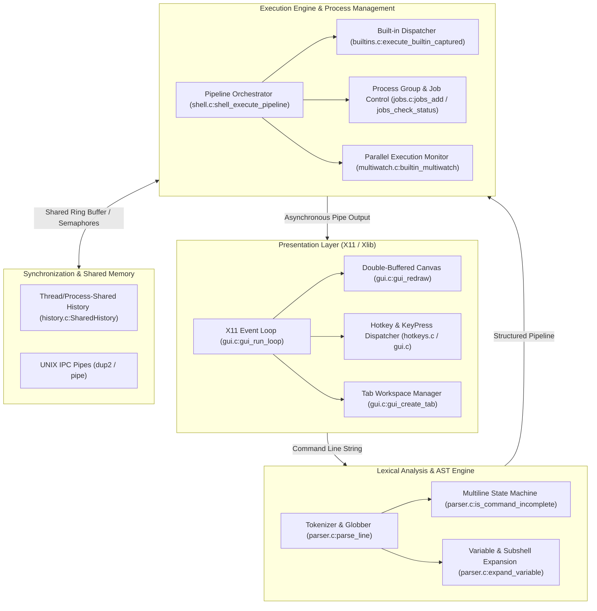
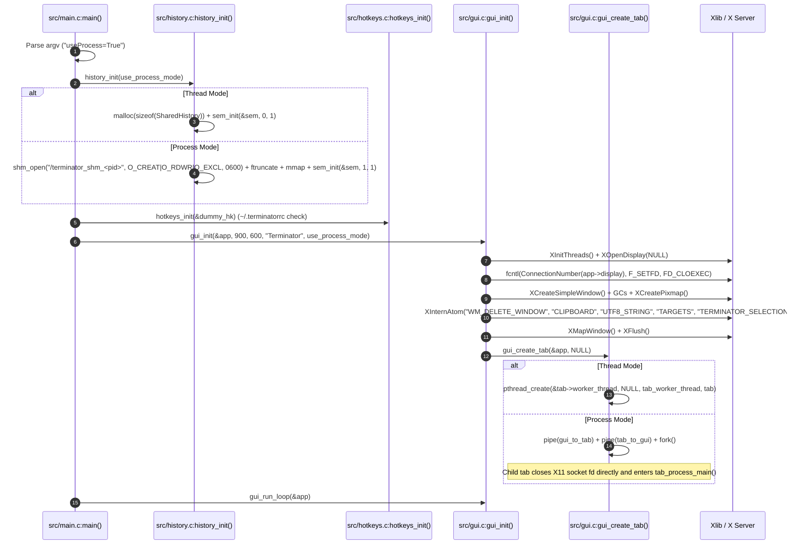
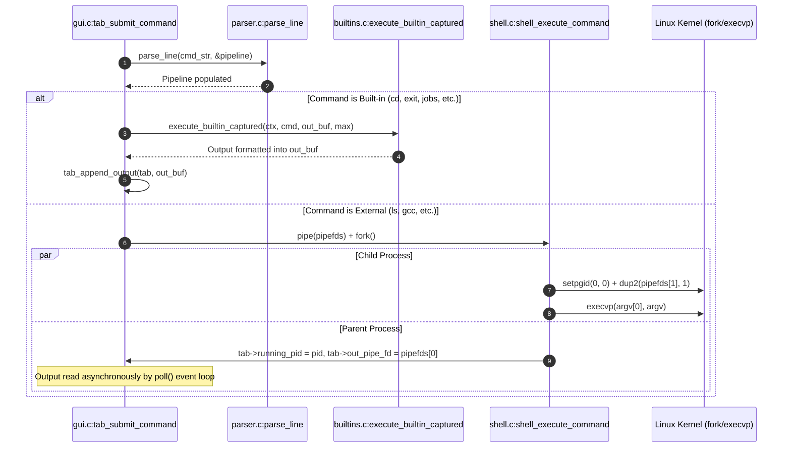
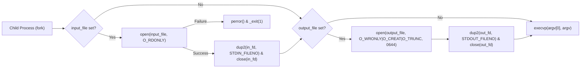
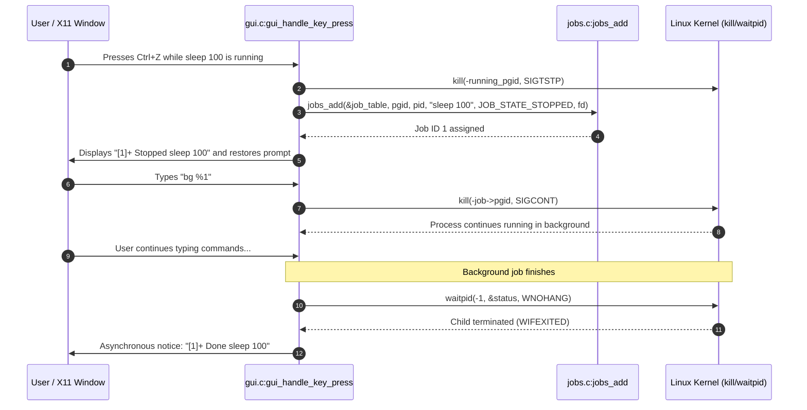
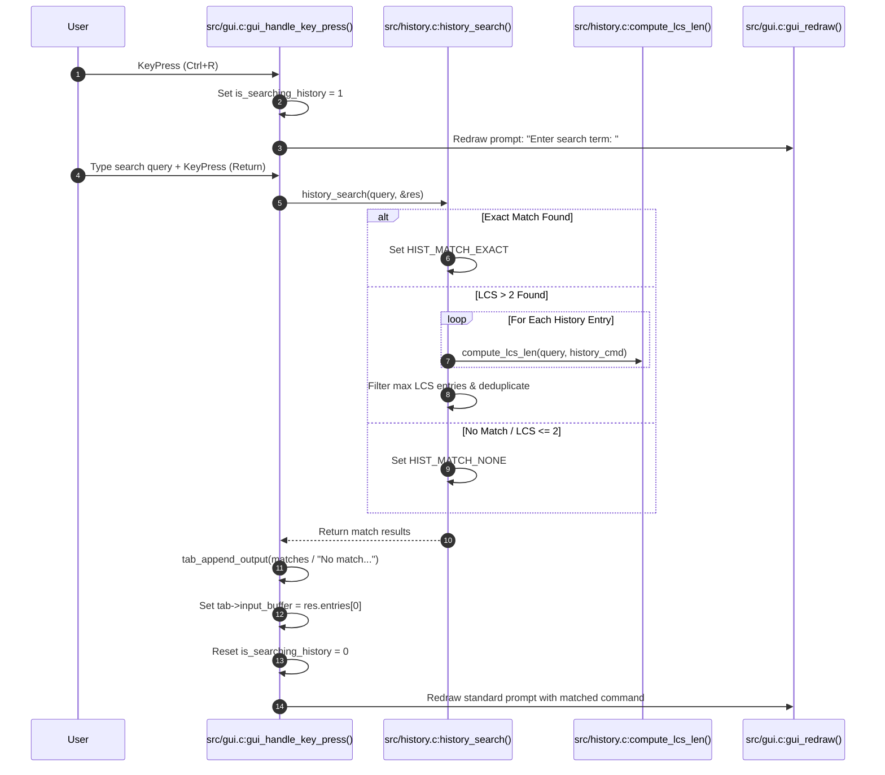
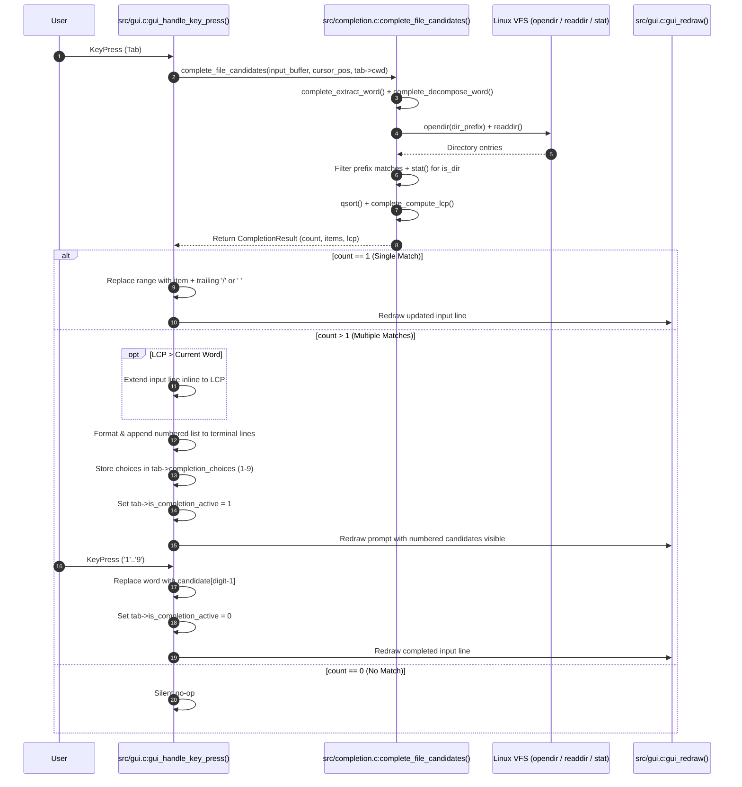
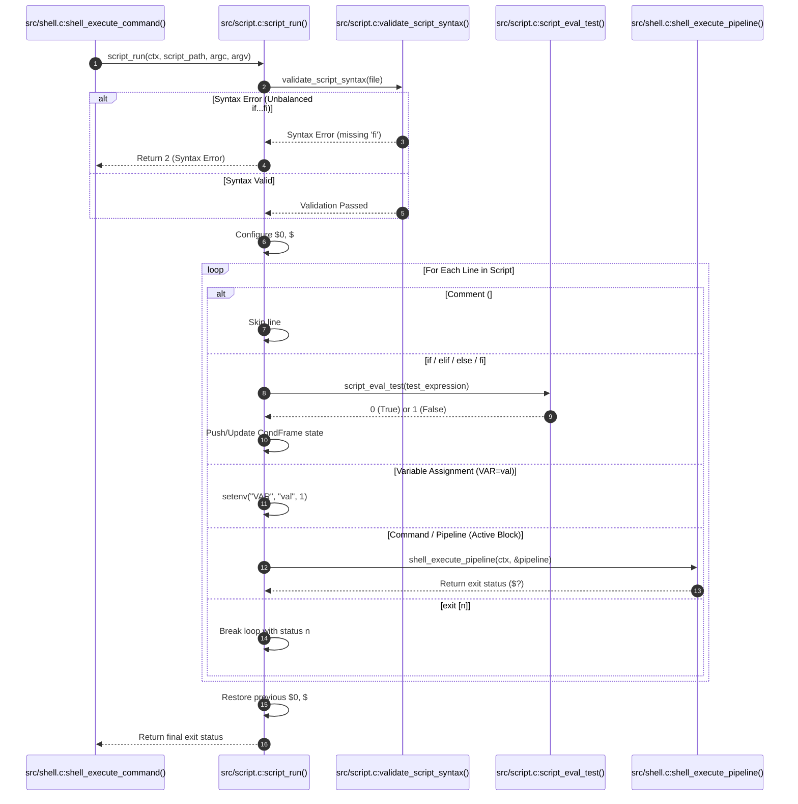
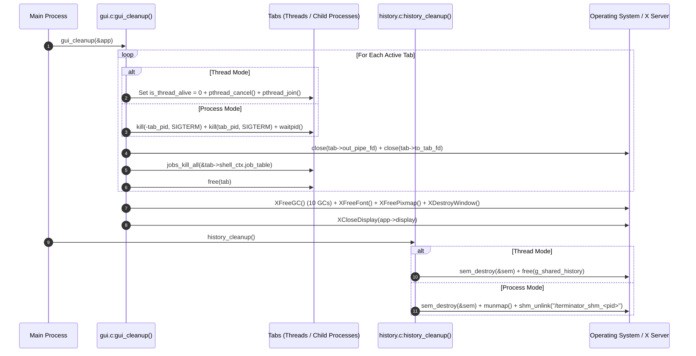

# Terminator: Comprehensive System Design & Execution Architecture
**Computing Lab (CS69201) · Term Project · IIT Kharagpur**

---

## 1. System Architecture & Module Inventory

### 1.1 High-Level Architecture Overview

Terminator is a dual-paradigm Unix terminal emulator and POSIX-compliant command shell developed in C11 for Linux. It combines a custom graphical user interface built directly upon the Xlib/X11 API with an asynchronous execution engine. Terminator decouples the presentation layer from the execution engine, enabling two distinct process isolation models:
1. **Thread Mode (Default: `./terminator`)**: The entire emulator runs in a single process. Tabs operate as POSIX worker threads (`pthread_t`) that share application memory while synchronizing access to shared command history via POSIX semaphores (`sem_init(&g_shared_history->sem, 0, 1)`). Only the main GUI thread interacts with the X11 display socket.
2. **Process Mode (`./terminator useProcess=True`)**: The GUI runs inside the parent process, while each workspace tab runs as a dedicated child process created via `fork()`. Communication between the GUI and tab processes is maintained over non-blocking UNIX IPC pipes (`to_tab_fd` and `out_pipe_fd`). Command history is maintained in POSIX Shared Memory (`shm_open`, `ftruncate`, `mmap`) synchronized via a process-shared semaphore (`sem_init(&g_shared_history->sem, 1, 1)`).

The architecture multiplexes X11 display server events and child process I/O descriptors inside a central non-blocking `poll()` event loop, preventing UI freezes without busy-waiting.



---

### 1.2 File & Module Inventory

| File Name | Header | Role & Responsibility | Core Functions & Key Structs |
| :--- | :--- | :--- | :--- |
| `src/main.c` | None | Primary process entry point; mode flag evaluation (Thread Mode vs Process Mode) and GUI lifecycle controller. | `main()` |
| `src/gui.c` | `include/gui.h` | X11 window management; double-buffering; tab lifecycle; input editing; event loop. | `gui_init()`, `gui_cleanup()`, `gui_run_loop()`, `gui_redraw()`, `gui_create_tab()`, `gui_close_tab()`, `gui_switch_tab()`, `tab_submit_command()`, `gui_handle_key_press()`, `gui_handle_button_press()`, `tab_process_main()`, `tab_worker_thread()`<br>Structs: `GuiApp`, `Tab`, `TermLine`, `LineType` |
| `src/parser.c` | `include/parser.h` | Lexer, tokenizer, multiline state machine, quote stripper, `$VAR` expander, command substitution, and wildcard globber. | `parse_line()`, `is_command_incomplete()`, `expand_variable()`, `execute_substitution()`, `flush_token()`, `free_pipeline()`, `free_command()`<br>Structs: `Command`, `Pipeline` |
| `src/shell.c` | `include/shell.h` | Pipeline orchestrator; I/O redirection; external process fork/exec; process group leader. | `shell_init()`, `shell_cleanup()`, `shell_execute_pipeline()`, `shell_execute_command()`, `setup_redirections()`<br>Structs: `ShellContext` |
| `src/builtins.c`| `include/builtins.h`| Built-in implementations affecting shell state; unified output capturing for GUI/pipes. | `is_builtin_command()`, `execute_builtin()`, `execute_builtin_captured()`, `builtin_cd()`, `builtin_exit()`, `builtin_clear()`, `builtin_jobs()`, `builtin_bg()`, `builtin_fg()`, `builtin_history()`, `builtin_source()` |
| `src/jobs.c` | `include/jobs.h` | POSIX job control table; process group tracking; asynchronous completion notifications. | `jobs_init()`, `jobs_add()`, `jobs_remove()`, `jobs_find_by_id()`, `jobs_find_by_pid()`, `jobs_check_status()`, `jobs_print()`, `jobs_builtin_bg()`, `jobs_builtin_fg()`, `jobs_kill_all()`, `jobs_get_current()`<br>Structs: `JobTable`, `Job`, `JobState` |
| `src/history.c` | `include/history.h` | Persistent 10,000-command history ring buffer; disk persistence (`~/.terminator_history`); compaction (>20,000); 3-tier LCS search engine. | `history_init()`, `history_cleanup()`, `history_add()`, `history_get_relative()`, `history_count()`, `history_format_recent()`, `history_search()`, `hist_search_result_free()`, `history_encode_line()`, `history_decode_line()`<br>Structs: `SharedHistory`, `HistSearchResult`, `HistMatchType` |
| `src/completion.c` | `include/completion.h` | Context-aware Tab file-name auto-completion engine; word extraction with quote/escape handling; LCP computation; candidate formatter. | `complete_extract_word()`, `complete_unescape_word()`, `complete_escape_filename()`, `complete_decompose_word()`, `complete_compute_lcp()`, `complete_file_candidates()`, `complete_format_numbered_list()`, `completion_result_free()`<br>Structs: `CompletionResult` |
| `src/script.c` | `include/script.h` | In-house bash script runner; control flow evaluator; conditional evaluator `[ ... ]`; positional parameter manager; recursion guard. | `script_run()`, `is_bash_script()`, `script_eval_test()`<br>Structs: `CondFrame` |
| `src/multiwatch.c`| `include/multiwatch.h`| Concurrent parallel command execution; 2.0s refresh timer; formatted banner rendering to GUI pipe/stdout. | `builtin_multiwatch()`, `builtin_multiwatch_fd()`, `parse_multiwatch_commands()`, `spawn_watched_cmd()`, `print_formatted_output()`<br>Structs: `WatchedCmd` |
| `src/hotkeys.c` | `include/hotkeys.h` | Keybinding configuration reader (`~/.terminatorrc`); conflict detector; X11 KeySym mapper. | `hotkeys_init()`, `hotkeys_match()`, `check_and_resolve_conflicts()`, `parse_combo_string()`<br>Structs: `HotkeyConfig`, `HotkeyBinding`, `HotkeyAction` |

---

## 2. Global Initialization & Bootstrap Flow

Before the user can type commands, Terminator initializes subsystems according to the selected mode.



### 2.1 Detailed Call Chain Trace

1. **`main.c:main(argc, argv)`**:
   - Evaluates command-line flags: checks for `useProcess=True` to activate Process Mode (`use_process_mode = 1`), or defaults to Thread Mode (`use_process_mode = 0`).
   - Prints startup mode banner: `[Terminator] Mode: Thread Mode (default)` or `[Terminator] Mode: Process Mode (useProcess=True)`.
2. **`history.c:history_init(use_process_mode)`**:
   - In **Thread Mode** (`use_process_mode == 0`): Allocates heap memory `malloc(sizeof(SharedHistory))`. Initializes thread-shared POSIX semaphore `sem_init(&g_shared_history->sem, 0, 1)`.
   - In **Process Mode** (`use_process_mode == 1`): Formats unique shared memory path `/terminator_shm_<pid>` using `getpid()`. Calls `shm_unlink()` to clear any stale object, then `shm_open(shm_path, O_CREAT | O_RDWR | O_EXCL, 0600)`, truncates with `ftruncate(fd, sizeof(SharedHistory))`, maps with `mmap(NULL, sizeof(SharedHistory), PROT_READ | PROT_WRITE, MAP_SHARED, fd, 0)`, and initializes process-shared semaphore `sem_init(&g_shared_history->sem, 1, 1)`.
3. **`hotkeys.c:hotkeys_init(&cfg)`**:
   - Resolves `~/.terminatorrc`. If absent, writes default keybinding configuration via `write_default_config_file()`. Parses custom mappings, executes `check_and_resolve_conflicts()`, and falls back to default bindings if conflicts are found.
4. **GUI Initialization**:
   - Invokes `gui.c:gui_init(&app, 900, 600, "Terminator", use_process_mode)`. If the X server connection fails, reports error to stderr and exits with code 1.
5. **`gui.c:gui_init(app, width, height, title, use_process_mode)`**:
   - Calls `XInitThreads()`.
   - Establishes X11 display connection via `XOpenDisplay(NULL)` (falling back to `:0`).
   - Marks X11 connection socket with `FD_CLOEXEC` via `fcntl()` so child commands never inherit the X server descriptor.
   - Creates root simple window `XCreateSimpleWindow()`, loads monospace fonts, initializes double-buffering back buffer `Pixmap` via `XCreatePixmap()`.
   - Interns selection atoms (`WM_DELETE_WINDOW`, `CLIPBOARD`, `UTF8_STRING`, `TARGETS`, `TERMINATOR_SELECTION`).
   - Calls `XMapWindow()` and `XFlush()`.
   - Spawns Tab 1 via `gui.c:gui_create_tab(app, NULL)`.
6. **`gui.c:gui_create_tab(app, initial_cwd)`**:
   - Allocates `Tab` structure on heap. Initializes tab `ShellContext` and cwd.
   - If **Thread Mode**: sets `tab->is_thread_alive = 1` and calls `pthread_create(&tab->worker_thread, NULL, tab_worker_thread, tab)`.
   - If **Process Mode**: creates pipes `pipe(gui_to_tab)` and `pipe(tab_to_gui)`, calls `fork()`.
     - In Child Process: calls `setpgid(0, 0)`. Directly closes the child copy of the X11 connection socket descriptor (`close(ConnectionNumber(app->display))` and sets `app->display = NULL`). *Child MUST NOT call `XCloseDisplay()`*, because doing so sends protocol teardown packets over the socket that desynchronize XCB sequence numbers in the parent GUI event loop (`Assertion !xcb_xlib_threads_sequence_lost failed`). Child closes unused pipe ends and enters `tab_process_main(tab, gui_to_tab[0], tab_to_gui[1])`.
     - In Parent GUI Process: configures `tab->to_tab_fd = gui_to_tab[1]` and sets non-blocking mode on `tab->out_pipe_fd = tab_to_gui[0]` via `fcntl(O_NONBLOCK)`.

---

## 3. Task-by-Task / Command Execution Flows

---

### Task 1 — X11 GUI, Double-Buffering & Tab Multiplexing

#### 1. Trigger & Input
- Keystrokes inside X11 window (`KeyPress`), window resize (`ConfigureNotify`), window exposure (`Expose`), mouse clicks on tab bar / `[ + ]` button (`ButtonPress`), mouse wheel scroll (Button 4 / Button 5), or keyboard tab shortcuts (`Ctrl+T`, `Ctrl+Shift+W`, `Shift+Left`, `Shift+Right`).

#### 2. Step-by-Step Execution Trace
1. **`gui.c:gui_run_loop(GuiApp *app)`**:
   - Enters central while loop (`app->is_running`).
   - Drains pending X11 events via `while (XPending(app->display) > 0)`.
   - Dispatches `XNextEvent()`:
     - `Expose` $\rightarrow$ calls `gui.c:gui_redraw(app)`.
     - `ConfigureNotify` $\rightarrow$ updates `win_width`/`win_height`, re-allocates `app->back_buffer` Pixmap with `XCreatePixmap()`, calls `gui_redraw(app)`.
     - `KeyPress` $\rightarrow$ calls `gui.c:gui_handle_key_press(app, &ev.xkey)`.
     - `ButtonPress` $\rightarrow$ calls `gui.c:gui_handle_button_press(app, &ev.xbutton)`.
     - `ClientMessage` $\rightarrow$ checks `WM_DELETE_WINDOW`, sets `app->is_running = 0`.
2. **Multiplexing with Subprocess Pipes**:
   - Constructs `struct pollfd fds[]` array (capacity `MAX_POLL_ENTRIES = 1 + MAX_TABS * (1 + MAX_JOBS)`):
     - `fds[0].fd = ConnectionNumber(app->display)` (events = `POLLIN`).
     - For each tab: if `(t->is_running_cmd || t->use_process_mode) && t->out_pipe_fd >= 0`, adds `t->out_pipe_fd` (events = `POLLIN | POLLHUP`).
     - For each running background job: if `job->state == JOB_STATE_RUNNING && job->out_pipe_fd >= 0`, adds `job->out_pipe_fd`.
   - Executes `poll(fds, num_poll_fds, 50)` with a 50ms timeout to prevent busy-waiting.
3. **Reading Asynchronous Output**:
   - If `fds[i].revents & (POLLIN | POLLHUP)` triggers:
     - Invokes `read(fds[i].fd, buf, sizeof(buf))`.
     - If `buf` contains `[CWD]<path>\n`, extracts path into `tab->cwd` without printing and renders any remainder.
     - Otherwise invokes `gui.c:tab_append_output(tab, buf, n)`.
     - Sets `needs_redraw = 1`.
4. **Double-Buffered Rendering (`gui.c:gui_redraw`)**:
   - Fills background rectangle on `app->back_buffer` (`XFillRectangle`).
   - Renders tab buttons and anchored `[ + ]` button at `win_width - plus_w - 6`.
   - Computes visible scrollback row slice based on `tab->scroll_offset` and `tab->num_lines`.
   - Draws terminal text lines using `XDrawString()` into `app->back_buffer`.
   - Renders wrapped multiline user input buffer and block cursor (`XFillRectangle`).
   - Performs atomic blit to visible window via `XCopyArea(app->display, app->back_buffer, app->window, ...)` eliminating visual flicker.

```mermaid
flowchart TD
    A["poll() triggers (X11 event or Pipe data)"] --> B{Event Type?}
    B -->|X11 Event| C["gui_handle_key_press() / gui_handle_button_press()"]
    B -->|Pipe Data (POLLIN)| D["read(tab->out_pipe_fd)"]
    D --> E{Special [CWD] Tag?}
    E -->|Yes| F["Update tab->cwd for tab bar title"]
    E -->|No| G["tab_append_output() into tab->lines scrollback"]
    C --> H["Mark needs_redraw = 1"]
    G --> H
    H --> I["gui_redraw(): Paint into offscreen Pixmap"]
    I --> J["XCopyArea(): Blit Pixmap to X11 Window"]
```

---

### Task 2 — Built-in and External Command Execution

#### 1. Trigger & Input
- User presses <kbd>Return</kbd> on a single command (e.g., `ls -la`, `cd ~/Downloads`, `source script.sh`).

#### 2. Step-by-Step Execution Trace
1. **`gui.c:tab_submit_command(app, tab)`**:
   - Records prompt and input into scrollback buffer via `tab_record_prompt_input()`.
   - Checks multiline completeness using `parser.c:is_command_incomplete()`.
   - Appends finalized command to shared history via `history.c:history_add(cmd_str)`.
   - If **Process Mode**: writes command string to `tab->to_tab_fd` with `\n` and returns. The tab child process executes it inside `tab_process_main()`:
     - Built-ins run via `execute_builtin_captured()`; if `cd` succeeds, tab writes `[CWD]<path>\n` to `out_pipe_fd` to update the GUI tab bar.
     - External commands are forked with `dup2(out_fd, 1)` and `dup2(out_fd, 2)`.
   - If **Thread Mode**: passes `cmd_str` to `parser.c:parse_line()`.
2. **`parser.c:parse_line(cmd_str, ctx, pipeline)`**:
   - Splits tokens on whitespace, recognizing single quotes `'`, double quotes `"`, and redirections `<`, `>`.
   - Populates `Pipeline` containing an array of `Command` structs.
3. **Built-in Execution Path**:
   - Evaluates early terminal controls (`exit`, `clear`) in `tab_submit_command` before execution mode dispatch:
     - `exit`: calls `gui_close_tab(app, cur_idx)` and immediate `gui_redraw(app)`. In Process Mode, EOF on tab pipe also closes the tab container.
     - `clear`: wipes `tab->num_lines = 0; tab->scroll_offset = 0;` and triggers immediate `gui_redraw(app)`.
   - Checks `builtins.c:is_builtin_command(cmd->argv[0])`.
   - For instantaneous shell built-ins: calls `builtins.c:execute_builtin_captured(&tab->shell_ctx, cmd, out_buf, sizeof(out_buf))`.
     - `cd`: calls `builtin_cd()` $\rightarrow$ expands `~` to `$HOME` $\rightarrow$ calls `chdir()` $\rightarrow$ calls `getcwd()` updating `ctx->cwd`.
     - `jobs`: calls `jobs_print()` formatting background table into `out_buf`.
     - `bg`: calls `jobs_builtin_bg()` $\rightarrow$ sends `kill(-pgid, SIGCONT)` $\rightarrow$ sets state `Running`.
     - `fg`: calls `jobs_builtin_fg()` $\rightarrow$ sends `kill(-pgid, SIGCONT)` $\rightarrow$ connects pipe to foreground view in GUI.
     - `history`: calls `history.c:history_format_recent()` $\rightarrow$ dumps recent 1,000 commands.
     - `source`: calls `builtin_source()` $\rightarrow$ opens file via `fopen()` $\rightarrow$ executes each line in shell context.
   - For `multiWatch`: Bypasses synchronous `execute_builtin_captured()` to prevent blocking the GUI thread. Instead, dispatches via a dedicated child pipeline wired to the tab's non-blocking read pipe, streaming live output into the X11 canvas every 2 seconds.
   - Appends `out_buf` to tab scrollback via `tab_append_output()`.
4. **External Command Execution Path (`gui.c:tab_submit_command` / `shell.c:shell_execute_command`)**:
   - Creates communication pipe `pipe(pipefds)`.
   - Calls `fork()`.
   - **Child Process (`pid == 0`)**:
     - Calls `setpgid(0, 0)` establishing a new process group.
     - Duplicates write-end to stdout and stderr: `dup2(pipefds[1], STDOUT_FILENO)` and `dup2(pipefds[1], STDERR_FILENO)`.
     - Closes both pipe ends: `close(pipefds[0]); close(pipefds[1]);`.
     - Applies redirections via `shell.c:setup_redirections()`.
     - Calls `execvp(cmd->argv[0], cmd->argv)`.
     - On failure: prints `terminator: <cmd>: command not found` to stderr and calls `_exit(127)`.
   - **Parent Process (`pid > 0`)**:
     - Closes write-end `close(pipefds[1])`.
     - Sets read-end `pipefds[0]` to non-blocking via `fcntl(O_NONBLOCK)`.
     - Sets `tab->running_pid = pid`, `tab->running_pgid = pid`, `tab->out_pipe_fd = pipefds[0]`, `tab->is_running_cmd = 1`.
     - Returns control immediately to `gui_run_loop()`, which reads output asynchronously via `poll()`.



---

### Task 3 — Multiline Input, Quoting & Command Substitution

#### 1. Trigger & Input
- Unclosed quote (`echo "hello`), trailing backslash (`ls \`), trailing pipe (`cat file.txt |`), unclosed command substitution (`echo $(pwd)`), or backticks.

#### 2. Step-by-Step Execution Trace
1. **Continuation Detection (`parser.c:is_command_incomplete`)**:
   - Scans input character-by-character:
     - Maintains quote state flags: `in_sq` (single quote `'`), `in_dq` (double quote `"`), `in_bt` (backtick `` ` ``).
     - Maintains parenthesis nesting depth: `sub_depth` incremented on `$(` and decremented on `)`.
     - Detects trailing unescaped `\` or trailing `|`.
   - If any state flag is non-zero, returns `1`.
2. **GUI Prompt Transition**:
   - `tab_submit_command()` detects `is_command_incomplete() == 1`.
   - Sets `tab->is_multiline = 1`.
   - Switches active prompt from `user@terminator> ` to `> `.
   - Accumulates subsequent typed lines into `tab->multiline_accum` separated by `\n`.
3. **Variable & Substitution Expansion (`parser.c:expand_variable`)**:
   - When the command is complete, `parse_line()` tokenizes the buffer.
   - For unquoted or double-quoted segments:
     - `$VAR`: queries `getenv("VAR")` and substitutes value.
     - `$?`: formats `ctx->last_exit_status` as integer string.
     - `$(cmd)` or `` `cmd` ``: calls `parser.c:execute_substitution(sub_cmd, ctx, out_buf)`.
4. **Nested Command Substitution Execution (`parser.c:execute_substitution`)**:
   - Recursively executes inner subshell command before outer command:
     - Creates pipe `pipe(pipefds)`.
     - Calls `fork()`.
     - Child process: redirects stdout to `pipefds[1]` (`dup2`), parses inner command, executes via `shell_execute_pipeline()`, and calls `_exit()`.
     - Parent process: reads captured stdout from `pipefds[0]`, strips trailing POSIX newlines (`\r`/`\n`), and injects string into argument token.

---

### Task 4 — I/O Redirection

#### 1. Trigger & Input
- Command tokens containing `< input_file`, `> output_file`, or `./prog < in.txt > out.txt`.

#### 2. Step-by-Step Execution Trace
1. **Parsing Redirections (`parser.c:parse_single_command`)**:
   - Detects `<` operator: extracts filename into `cmd->input_file`.
   - Detects `>` operator: extracts filename into `cmd->output_file`.
   - If wildcard expansion on redirection target yields multiple files: reports `terminator: <token>: ambiguous redirect` and returns `-1`.
   - Strips redirection tokens from `cmd->argv` so arguments are clean for `execvp()`.
2. **Applying Redirections in Child Process (`shell.c:setup_redirections`)**:
   - For `input_file`:
     - Calls `open(input_file, O_RDONLY)`.
     - If file does not exist (`in_fd < 0`): prints error `terminator: <file>: <strerror>` to stderr and halts execution immediately (`_exit(1)`).
     - Calls `dup2(in_fd, STDIN_FILENO)` and `close(in_fd)`.
   - For `output_file`:
     - Calls `open(output_file, O_WRONLY | O_CREAT | O_TRUNC, 0644)`.
     - Calls `dup2(out_fd, STDOUT_FILENO)` and `close(out_fd)`.
3. **Built-in Redirection Handling (`shell.c:shell_execute_command`)**:
   - In subshells or scripted pipelines, if a built-in has redirections, Terminator uses `dup()` to save original stdin/stdout, applies redirections, runs the built-in, and restores original descriptors via `dup2()`.



---

### Task 5 — Pipelines & Pathname Globbing

#### 1. Trigger & Input
- Pipeline of $N$ commands: `cat file.txt | grep error | wc -l`, or wildcard arguments: `ls *.c`, `rm ~/tmp/*.o`.

#### 2. Step-by-Step Execution Trace
1. **Pathname Expansion / Globbing (`parser.c:flush_token`)**:
   - Before adding an unquoted token to `cmd->argv`, tests for wildcard characters (`*`, `?`, `[`, `~`).
   - If present: invokes `glob(token, GLOB_NOCHECK | GLOB_TILDE, NULL, &glob_buf)`.
   - Appends all matched paths in alphabetical order into `cmd->argv`.
   - Calls `globfree(&glob_buf)`. Quoted wildcards (e.g. `"*.c"`) are preserved literally.
2. **Pipeline Plumbing (`shell.c:shell_execute_pipeline`)**:
   - For $N$ commands, allocates `int *pipefds = malloc(sizeof(int) * 2 * (N - 1))`.
   - Loops $i$ from 0 to $N-1$:
     - If $i < N - 1$, calls `pipe(pipefds + (i * 2))`.
     - Calls `fork()`.
     - In Child $i$:
       - If $i == 0$: sets process group leader via `setpgid(0, 0)`.
       - If $i > 0$: joins leader's group via `setpgid(0, pids[0])` and attaches stdin: `dup2(pipefds[(i - 1) * 2], STDIN_FILENO)`.
       - If $i < N - 1$: attaches stdout: `dup2(pipefds[i * 2 + 1], STDOUT_FILENO)`.
       - Applies any overriding file redirections (`<` or `>`).
       - Closes all $2(N-1)$ pipe descriptors in child.
       - Invokes `execvp(cmd->argv[0], cmd->argv)` or executes built-in.
   - In Parent:
     - Closes all $2(N-1)$ pipe descriptors immediately so reader processes receive `EOF` when writers terminate.
     - Waits for all $N$ child processes using `waitpid()`.
     - Captures exit status of the rightmost command ($N-1$) into `ctx->last_exit_status`.
3. **Background Pipelines (`pipeline->is_background`)**:
   - Forks background supervisor process. If stdin is unredirected, redirects stdin from `/dev/null`.
   - Registers job into `tab->shell_ctx.job_table`, prints `[id] pid`, and returns immediately.

```mermaid
flowchart LR
    subgraph Pipeline_Execution ["N Commands, N-1 Pipes"]
        C1["Child 0 (cat)"] -->|pipefds[0]| C2["Child 1 (grep)"]
        C2 -->|pipefds[1]| C3["Child 2 (wc)"]
    end
    Parent["Parent Process"] -.->|Closes all pipe ends & waits| C3
```

---

### Task 6 — `multiWatch`

#### 1. Trigger & Input
- Command syntax: `multiWatch ["date +%T", "ls | wc -l"]`.

#### 2. Step-by-Step Execution Trace
1. **Argument Parsing (`multiwatch.c:parse_multiwatch_commands`)**:
   - Extracts command strings from brackets `[...]` and comma-separated lists. Strips outer quotes and trims whitespace into `WatchedCmd` structures.
2. **Signal Handling Configuration**:
   - Registers dedicated signal handler `mw_sigint_handler()` on `SIGINT` (`Ctrl+C`), setting `g_mw_interrupted = 1`.
3. **Execution & Refresh Engine (`multiwatch.c:builtin_multiwatch`)**:
   - Spawns all watched commands initially in parallel via `spawn_watched_cmd()`, wiring non-blocking pipes to each child.
   - Loops while `!g_mw_interrupted`:
     - Checks timestamp `now = time(NULL)`. For any command with `pid == 0` whose elapsed time `now - last_finish_time >= 2`, respawns it automatically.
     - Gathers read-ends into `struct pollfd pfds[]`.
     - Calls `poll(pfds, num_active, 100)` with a 100ms timeout slice.
     - When `POLLIN` fires: reads output chunk into `cmd->output_buf`.
     - When child finishes (`waitpid(cmd->pid, &status, WNOHANG) > 0`):
       - Drains remaining bytes from pipe, closes pipe descriptor.
       - Records finish timestamp `cmd->last_finish_time = time(NULL)`.
       - Calls `print_formatted_output(&cmds[i], out_fd)` using `dprintf(out_fd, ...)` directly to the GUI tab pipe descriptor (`out_fd` / `STDOUT_FILENO`):
         ```text
         "cmd", <timestamp>:
         ----------------------------------------------------
         <output>
         ----------------------------------------------------
         ```
       - The central `gui_run_loop()` polls the pipe, dynamically appending text to the active tab scrollback and redrawing the X11 canvas without UI lockup.
       - Resets `output_buf` for subsequent execution cycles.
4. **Interruption & Teardown**:
   - When user presses `Ctrl+C` in the X11 window: `gui_handle_key_press()` forwards `SIGINT` to the running command process group.
   - `g_mw_interrupted` flag becomes 1 via `mw_sigint_handler()`.
   - Iterates through active commands, sending `kill(-cmd->pid, SIGTERM)` and `kill(cmd->pid, SIGTERM)`.
   - Closes open pipes and reaps processes via `waitpid(cmd->pid, NULL, WNOHANG)`.
   - Restores original `sigaction(SIGINT)` handler and returns to prompt.

---

### Task 7 — Hotkeys & Dynamic Configuration

#### 1. Trigger & Input
- Key combinations in GUI: `Ctrl+A`, `Ctrl+E`, `Ctrl+U`, `Ctrl+K`, `Ctrl+W`, `Ctrl+L`, `Ctrl+D`, `Ctrl+Shift+C`, `Ctrl+Shift+V`, `Up`, `Down`, as well as tab shortcuts (`Ctrl+T`, `Ctrl+Shift+W`, `Shift+Left`, `Shift+Right`).

#### 2. Step-by-Step Execution Trace
1. **Config Initialization (`hotkeys.c:hotkeys_init`)**:
   - Reads `~/.terminatorrc` at startup. If absent, writes default template.
   - Parses binding strings into X11 modifier bitmasks (`ControlMask`, `ShiftMask`, `Mod1Mask`) and KeySyms via `XStringToKeysym()`.
   - Runs `check_and_resolve_conflicts()`: if duplicate bindings exist, reverts conflicting actions to defaults with a warning.
2. **Matching & Execution (`gui.c:gui_handle_key_press`)**:
   - Calls `hotkeys.c:hotkeys_match(&app->hotkeys, event, keysym)`.
   - Dispatches matched action:
     - `HOTKEY_MOVE_START`: sets `tab->cursor_pos = 0`.
     - `HOTKEY_MOVE_END`: sets `tab->cursor_pos = tab->input_len`.
     - `HOTKEY_DELETE_TO_START`: deletes slice `[0, cursor_pos]` via `tab_delete_range()`.
     - `HOTKEY_DELETE_TO_END`: deletes slice `[cursor_pos, input_len]`.
     - `HOTKEY_DELETE_WORD`: steps backward past spaces then word characters, deleting range.
     - `HOTKEY_CLEAR_SCREEN`: resets `tab->num_lines = 0; tab->scroll_offset = 0;`.
     - `HOTKEY_EXIT_SHELL`: if input empty, closes tab via `gui_close_tab()`.
     - `HOTKEY_COPY`: copies `tab->input_buffer` to `app->clipboard_data` and asserts X11 ownership of `CLIPBOARD` and `XA_PRIMARY` atoms (`XSetSelectionOwner`).
     - `HOTKEY_PASTE`: requests selection transfer from clipboard via `XConvertSelection()`. Output arrives as `SelectionNotify` event in `gui_run_loop()` and inserts text at cursor.
     - `HOTKEY_HISTORY_PREV`: if input is wrapped across lines and cursor is not on the top row, moves cursor up one line; otherwise browses older history via `history_get_relative(tab->history_pos++)`.
     - `HOTKEY_HISTORY_NEXT`: if input is wrapped across lines and cursor is not on the bottom row, moves cursor down one line; otherwise moves toward newer history, restoring in-progress typing from `tab->saved_input` when returning to the bottom.

---

### Task 8 — Signals & Job Control

#### 1. Trigger & Input
- Keystrokes `Ctrl+C`, `Ctrl+Z`, command suffix `&` (`sleep 100 &`), or built-ins `jobs`, `fg %id`, `bg %id`.

#### 2. Step-by-Step Execution Trace
1. **Foreground Signal Delivery (`gui.c:gui_handle_key_press`)**:
   - X11 intercepts keystrokes as `KeyPress` events. Terminator converts them into OS signals:
     - In **Process Mode**:
       - `Ctrl+C`: sends `kill(-tab->tab_pid, SIGINT)` directly to the dedicated tab child process group.
       - `Ctrl+Z`: sends `kill(-tab->tab_pid, SIGTSTP)` directly to the dedicated tab child process group.
     - In **Thread Mode**:
       - `Ctrl+C`: if foreground command running, sends `kill(-tab->running_pgid, SIGINT)` and `kill(tab->running_pid, SIGINT)`. Terminator itself never terminates.
       - `Ctrl+Z`: sends `kill(-tab->running_pgid, SIGTSTP)` and `kill(tab->running_pid, SIGTSTP)`.
2. **Suspending into Job Table (`gui.c:gui_handle_key_press`)**:
   - In Thread Mode on `Ctrl+Z`, registers stopped process group in table:
     `jobs_add(&tab->shell_ctx.job_table, pgid, pid, cmd, JOB_STATE_STOPPED, pipe_fd)`.
   - Prints status notice: `[^Z\n[1]+  Stopped                 <cmd>]`.
   - Clears `tab->is_running_cmd = 0`, freeing prompt for input.
3. **Background Execution (`cmd &`)**:
   - `parser.c:parse_line()` detects trailing `&`, sets `pipeline->is_background = 1`.
   - Spawns process group in background.
   - Registers job in `tab->shell_ctx.job_table`, sets `tab->is_running_cmd = 0`, and prints launch notice `[1] <pid>`. Prompt returns immediately.
4. **Resuming Jobs (`bg` and `fg`)**:
   - `bg %id`: resolves Job entry via `jobs_find_by_id()`, broadcasts `kill(-job->pgid, SIGCONT)`, updates state to `JOB_STATE_RUNNING`, and prints `[id]+ <cmd> &`.
   - `fg %id`: resolves Job entry via `jobs_builtin_fg()`, broadcasts `kill(-job->pgid, SIGCONT)`, removes from background table, and re-attaches `job->out_pipe_fd` to foreground view in GUI.
5. **Asynchronous Completion Notices (`jobs_check_status`)**:
   - Inside `gui_run_loop()`, each poll cycle invokes `jobs_check_status(&tab->shell_ctx.job_table, notif_buf, sizeof(notif_buf))`.
   - Calls `waitpid(j->pid, &status, WNOHANG | WUNTRACED | WCONTINUED)`.
   - If a background job terminated, formats notice: `[id]+  Done                    <cmd>\n`, removes job from table, and prints notice into active tab scrollback.



---

### Task 9 — Searchable and Persistent Command History

#### 1. Trigger & Input
- **Automatic Appending**: Every command executed via <kbd>Return</kbd> in interactive mode is committed to shared history.
- **`history` Built-in Command**: Invoked by user command `history` (displays up to the last 1,000 commands formatted as `%5d  %s\n`).
- **Interactive Reverse Search (`Ctrl+R`)**: User presses <kbd>Ctrl+R</kbd> in the GUI terminal. The prompt switches to `Enter search term: `, accepting user query input until <kbd>Return</kbd> (to search) or <kbd>Esc</kbd>/<kbd>Ctrl+C</kbd> (to cancel).

#### 2. Step-by-Step Execution Trace
1. **Startup Loading & Compaction (`history.c:history_init`)**:
   - Determines persistence file path from `TERMINATOR_HISTFILE` environment variable (default: `~/.terminator_history`).
   - Acquires the shared semaphore `sem_wait(&g_shared_history->sem)`.
   - Counts total lines in the persistence file. If lines exceed 20,000, enforces compaction: reads file, keeps only the most recent 10,000 lines, writes them atomically to a temporary file, and renames it over `~/.terminator_history`.
   - Decodes stored lines using `history_decode_line()` (reversing `\n` and `\\` escape sequences) and loads up to 10,000 commands into the in-memory circular ring buffer `g_shared_history->commands`.
   - Releases semaphore `sem_post(&g_shared_history->sem)`.
2. **Appending Commands (`history.c:history_add`)**:
   - Acquires semaphore: `sem_wait(&g_shared_history->sem)`.
   - Ignores empty commands or commands identical to the most recent entry (deduplication).
   - Copies command string to `g_shared_history->commands[g_shared_history->head]`.
   - Advances head pointer: `head = (head + 1) % MAX_HISTORY_COMMANDS` (10,000).
   - Updates `count = count < 10000 ? count + 1 : 10000`.
   - Encodes command via `history_encode_line()` and appends to disk file via `fopen(path, "a")`.
   - Releases semaphore `sem_post(&g_shared_history->sem)`.
3. **3-Tier Reverse Search Algorithm (`history.c:history_search`)**:
   - **Tier 1 (Exact Match)**: Scans commands from newest to oldest (`offset = 0 ... count - 1`). If `strcmp(cand, term) == 0`, immediately populates `res->entries[0]` with `cand`, sets `match_type = HIST_MATCH_EXACT`, and returns.
   - **Tier 2 (Maximal Longest Common Subsequence / Substring)**: If no exact match exists, computes LCS length between `term` and all stored commands using dynamic programming (`compute_lcs_len()`). Identifies maximal LCS length `best_lcs`. If `best_lcs > 2`, collects all commands tied for `best_lcs`, deduplicating identical entries, orders them most-recent-first, sets `match_type = HIST_MATCH_SUBSTRING`, and returns.
   - **Tier 3 (No Match)**: If no exact match and `best_lcs <= 2`, sets `match_type = HIST_MATCH_NONE` and `count = 0`.
4. **GUI Interactive Handling (`gui.c:gui_handle_key_press`)**:
   - On <kbd>Ctrl+R</kbd>: sets `tab->is_searching_history = 1`, clears `tab->search_query`.
   - While `is_searching_history == 1`:
     - Displays red prompt `Enter search term: ` with green user query.
     - On <kbd>Return</kbd>: appends `Enter search term: <query>\n` to scrollback, invokes `history_search()`. If matched, prints all matching commands, loads the most recent match directly into `tab->input_buffer`, resets search mode, and redraws terminal ready for editing or execution. If no match, prints `No match for search term in history\n`.
     - On <kbd>Esc</kbd> or <kbd>Ctrl+C</kbd>: cancels search mode silently, restoring prompt.

#### 3. Call Graph / Sequence Diagram


#### 4. Error Handling & Edge Cases
- **Blank Search String**: Empty or whitespace-only search queries safely yield `HIST_MATCH_NONE` with 0 allocations.
- **Corrupt History File**: Malformed or oversized lines on disk are safely skipped during startup decode.
- **Dead Process Mutex/Semaphore Recovery**: In Process Mode, semaphore/mutex state remains consistent across crashes via POSIX synchronization primitives.

---

### Task 10 — File-Name Auto-Completion

#### 1. Trigger & Input
- **<kbd>Tab</kbd> Key**: Pressed while typing a command path or argument in the active terminal input line.
- **Digit Keys (`1`..`9`)**: Pressed when candidate selection mode (`is_completion_active == 1`) is awaiting choice selection.

#### 2. Step-by-Step Execution Trace
1. **Word Boundary Extraction (`completion.c:complete_extract_word`)**:
   - Parses the input buffer backward from cursor position `cursor_pos`.
   - Recognizes quotes (`'` and `"`) and backslash escapes (`\ `). Unescaped spaces, tabs, pipe symbols (`|`), and redirection operators (`<`, `>`) delineate argument boundaries.
   - Computes `word_start` and `word_len`.
2. **Word Decomposition (`completion.c:complete_decompose_word`)**:
   - Locates the rightmost slash `/` in the word.
   - Separates path into `dir_prefix` (e.g., `src/`, `~/subdir/`) and `file_prefix` (e.g., `te`, `prog`).
   - Unescapes `dir_prefix` and expands `~` to `$HOME`. If no directory prefix is present, targets the tab's isolated `cwd`.
3. **Candidate Gathering & LCP Computation (`completion.c:complete_file_candidates`)**:
   - Opens directory via `opendir(search_dir)`.
   - Scans directory entries via `readdir()`. Ignores `.` and `..`. Ignores hidden files (`.*`) unless `file_prefix` explicitly begins with `.`.
   - Matches entries prefixed with `file_prefix`.
   - For each match, checks `stat(full_path, &st)`: if `S_ISDIR(st.st_mode)`, appends a trailing `/`; otherwise appends filename as-is.
   - Sorts candidate array alphabetically using `qsort()`.
   - Computes Longest Common Prefix (LCP) across all matching candidates using `complete_compute_lcp()`.
4. **Completion Resolution (`gui.c:gui_handle_key_press`)**:
   - **Single Match (`count == 1`)**:
     - Escapes shell metacharacters in candidate using `complete_escape_filename()`.
     - Appends trailing `/` if directory, or space `' '` if regular file.
     - Calls `tab_delete_range()` to remove prefix, then `tab_insert_char()` to insert completed filename inline.
   - **Multiple Matches (`count > 1`)**:
     - If LCP extends beyond current word, extends text inline up to LCP.
     - Formats candidates into a numbered list via `complete_format_numbered_list()`:
       `1. abc.txt   2. abcd.txt`
     - Commits active prompt line to scrollback buffer, prints numbered list, and preserves active input on the next line.
     - Saves top candidate choices in `tab->completion_choices`, sets `tab->is_completion_active = 1`.
   - **Numbered Selection**:
     - User presses digit key (`'1'`..`'9'`).
     - Terminal replaces word prefix with chosen candidate `tab->completion_choices[idx]`, appends `' '` for files, frees completion state, and resumes normal input mode.
     - Any other key immediately dismisses candidate selection mode and processes keystroke normally.

#### 3. Call Graph / Sequence Diagram


#### 4. Error Handling & Edge Cases
- **No Match**: Silent no-op without altering cursor or printing error messages.
- **Spaces in Filenames**: Handled cleanly via `complete_escape_filename()`, prepending `\` to spaces and shell metacharacters.
- **Mid-Line Completion**: Only replaces `[word_start, word_start + word_len]`, preserving suffix characters after the cursor.
- **Per-Tab CWD Isolation**: Evaluates completion relative to `tab->cwd`, ensuring independent results per workspace tab.

---

### Task 11 — Running Bash Scripts

#### 1. Trigger & Input
- **Direct Execution**: `./script.sh [args...]` or `/path/to/script.sh [args...]`.
- **Interpreter Invocation**: `bash script.sh [args...]`.
- **Built-in Sourcing**: `source script.sh [args...]` or `. script.sh [args...]`.

#### 2. Step-by-Step Execution Trace
1. **Script Interception (`shell.c:shell_execute_command`)**:
   - Before forking, inspects `cmd->argv[0]`.
   - If command is `bash`, or matches `is_bash_script(cmd->argv[0])` (checking executable status, `.sh` extension, or `#!` shebang), execution is intercepted.
   - Forbids delegation to `/bin/bash` or `system()`; dispatches directly to the internal interpreter `script_run()`.
2. **Pre-Execution Syntax Validation (`script.c:validate_script_syntax`)**:
   - Reads script file line-by-line.
   - Tracks nesting depth of `if` statements and matching `fi` statements.
   - If an unbalanced `if` without `fi` or stray `fi` is detected, halts before executing any lines, prints `terminator: <script>: syntax error: unexpected end of file (missing 'fi')`, and sets exit status `2`.
3. **Execution Environment Setup (`script.c:script_run`)**:
   - Saves existing positional parameter state (`old_argc`, `old_argv`, `old_name`).
   - Configures script positional parameters:
     - `ctx->script_name` = script path (`$0`).
     - `ctx->script_argc` = argument count (`$#`).
     - `ctx->script_argv` = argument vector (`$1`..`$9`).
4. **Line-by-Line Execution & Control Flow**:
   - **Comments & Blank Lines**: Lines beginning with `#` (ignoring leading whitespace) or empty lines are skipped.
   - **Variable Assignments**: Statements matching `NAME=value` assign environment variables via `setenv(NAME, value, 1)`. In `source` mode, these persist in the parent tab context.
   - **Condition Stack Management (`CondFrame`)**:
     - Manages nested conditionals up to depth 32.
     - `if [ ... ]; then`: Evaluates test condition using `script_eval_test()`. If true, branches into `COND_THEN` (executes body); if false, skips body until matching `elif`, `else`, or `fi`.
     - `elif [ ... ]; then`: Evaluated only if preceding `if`/`elif` branches were false.
     - `else`: Executed only if no previous branch in the current `if` frame evaluated to true.
     - `fi`: Pops the active `CondFrame` from the condition stack.
   - **Test Operator Evaluation (`script.c:script_eval_test`)**:
     - Unary file tests: `-f` (regular file), `-d` (directory), `-e` (exists), `-s` (size > 0), `-r` (readable), `-w` (writable), `-x` (executable).
     - String tests: `=` / `==` (equality), `!=` (inequality), `-z` (empty string), `-n` (non-empty string).
     - Numeric tests: `-eq`, `-ne`, `-lt`, `-le`, `-gt`, `-ge`.
     - Logical negation: `!` prefix inverts condition truth value.
   - **Pipelines & Redirections**:
     - When condition frame permits execution, lines are expanded via `parse_line()` (resolving `$VAR`, `${VAR}`, `$0`..`$9`, `$#`, `$?`) and executed via `shell_execute_pipeline()`.
   - **Exit Termination**:
     - `exit [n]` immediately terminates script execution, returning status code `n` (defaulting to current `$?`).
5. **Teardown & Parameter Restoration**:
   - Restores parent positional parameters: `ctx->script_argc = old_argc`, `ctx->script_argv = old_argv`, `ctx->script_name = old_name`.
   - Closes open file handles and frees allocated line buffers.

#### 3. Call Graph / Sequence Diagram


#### 4. Error Handling & Edge Cases
- **Forbidden Subshell Delegation**: Never delegates execution to `/bin/bash` or `system()`; pure in-house interpretation guarantees assignment compliance.
- **Unbalanced Conditional Blocks**: Caught before executing statement 1, preventing partial side effects.
- **Positional Parameter Scope**: When a script is sourced (`source script.sh`), environment variables persist, but positional parameters (`$1`..`$9`) revert cleanly to prior values.
- **Recursion & Nesting**: Supports arbitrary conditional nesting up to depth 32 with bound checks preventing stack overflows.

---

## 4. Teardown & Cleanup Flow

Terminator provides leak-free teardown across both execution models.



### 4.1 Teardown Execution Steps

1. **Window Closure or Exit Command**:
   - Triggered by `ClientMessage` (`WM_DELETE_WINDOW`), `exit` built-in, or `Ctrl+D` on an empty prompt.
   - Sets `app->is_running = 0`, exiting `gui_run_loop()`.
2. **Tab Teardown (`gui.c:gui_cleanup`)**:
   - Iterates through open tabs:
     - Closes IPC pipe descriptors: `close(tab->out_pipe_fd)` and `close(tab->to_tab_fd)`.
     - In **Thread Mode**: sets `tab->is_thread_alive = 0`, invokes `pthread_cancel(tab->worker_thread)`, and blocks on `pthread_join(tab->worker_thread, NULL)`. If a foreground command is executing, signals it with `kill(-running_pgid, SIGTERM)`.
     - In **Process Mode**: broadcasts termination signals to the tab child process group via `kill(-tab->tab_pid, SIGTERM)` and `kill(tab->tab_pid, SIGTERM)`, and reaps with `waitpid(tab->tab_pid, NULL, WNOHANG)`.
     - Broadcasts `SIGTERM`, `SIGKILL`, and `SIGCONT` to all active background jobs via `jobs_kill_all(&tab->shell_ctx.job_table)`.
     - Deallocates the `Tab` structure via `free(tab)`.
3. **X11 Resource Deallocation**:
   - Frees Graphics Contexts: `XFreeGC(app->display, gc)` for all 10 allocated GCs (`gc_bg`, `gc_prompt`, `gc_input`, `gc_output`, `gc_cursor`, `gc_tab_bar_bg`, `gc_tab_active_bg`, `gc_tab_text`, `gc_tab_active_text`, `gc_scrollbar`).
   - Frees loaded monospace font struct: `XFreeFont(app->display, app->font)`.
   - Frees offscreen Pixmap buffer: `XFreePixmap(app->display, app->back_buffer)`.
   - Destroys top-level window: `XDestroyWindow(app->display, app->window)`.
   - Closes X11 display socket connection: `XCloseDisplay(app->display)`.
4. **Shared History Cleanup (`history.c:history_cleanup`)**:
   - Destroys POSIX semaphore via `sem_destroy(&g_shared_history->sem)`.
   - In **Thread Mode**: deallocates heap segment via `free(g_shared_history)`.
   - In **Process Mode**: unmaps shared memory segment via `munmap(g_shared_history, sizeof(SharedHistory))` and unlinks the named shared memory segment from `/dev/shm` via `shm_unlink(g_shm_name)`.

---

## 5. Cross-Reference Summary Table

| Task / Command | Entry Function (`File:Func`) | Core Worker Functions (`File:Func`) | Key Data Structures Modified | Helper / Utility Files Used |
| :--- | :--- | :--- | :--- | :--- |
| **System Startup** | `src/main.c:main` | `history_init`, `gui_init`, `hotkeys_init`, `gui_create_tab` | `GuiApp`, `SharedHistory`, `HotkeyConfig` | `history.c`, `gui.c`, `hotkeys.c` |
| **X11 Event Loop** | `src/gui.c:gui_run_loop` | `poll`, `gui_redraw`, `gui_handle_key_press`, `tab_append_output` | `GuiApp`, `struct pollfd[]` | `gui.c`, `Xlib` |
| **Double-Buffered Draw**| `src/gui.c:gui_redraw` | `XFillRectangle`, `XDrawString`, `XCopyArea` | `app->back_buffer`, `tab->lines` | `gui.c`, `Xlib` |
| **Tab Creation** | `src/gui.c:gui_create_tab` | `pthread_create` (Thread) / `pipe` + `fork` (Process) | `app->tabs[]`, `app->num_tabs`, `Tab` | `gui.c`, `pthread`, `unistd` |
| **Tab Destruction** | `src/gui.c:gui_close_tab` | `pthread_cancel` / `kill(SIGTERM+SIGKILL)`, `close`, `free` | `app->tabs[]`, `app->num_tabs`, `app->active_tab_idx` | `gui.c`, `jobs.c` |
| **Built-in Dispatch**| `src/builtins.c:execute_builtin_captured` | `builtin_cd`, `builtin_exit`, `builtin_jobs`, `builtin_source` | `ctx->cwd`, `ctx->should_exit`, `ctx->last_exit_status` | `builtins.c`, `jobs.c` |
| **External Command** | `src/shell.c:shell_execute_command` | `fork`, `setpgid`, `dup2`, `setup_redirections`, `execvp` | `ctx->foreground_pid`, `tab->running_pid` | `shell.c`, `unistd` |
| **Pipeline ($N$ Pipes)**| `src/shell.c:shell_execute_pipeline` | `pipe`, `fork`, `dup2`, `close`, `setpgid`, `waitpid` | `Pipeline`, `Command`, `ctx->last_exit_status` | `shell.c`, `parser.c` |
| **Multiline & Quote**| `src/parser.c:parse_line`| `is_command_incomplete`, `expand_variable`, `execute_substitution`| `tab->multiline_accum`, `tab->is_multiline` | `parser.c` |
| **Globbing Expansion**| `src/parser.c:flush_token`| `glob`, `globfree` | `cmd->argv[]`, `cmd->argc` | `parser.c`, `<glob.h>` |
| **`multiWatch`** | `src/multiwatch.c:builtin_multiwatch` | `parse_multiwatch_commands`, `spawn_watched_cmd`, `poll`, `dprintf` | `WatchedCmd[]`, `g_mw_interrupted` | `multiwatch.c`, `time.h` |
| **Hotkey Handling** | `src/gui.c:gui_handle_key_press` | `hotkeys_match`, `tab_delete_range`, `tab_insert_char` | `tab->input_buffer`, `tab->cursor_pos` | `gui.c`, `hotkeys.c` |
| **Signal Delivery** | `src/gui.c:gui_handle_key_press` | `kill(-pgid, SIGINT)`, `kill(-pgid, SIGTSTP)` | `tab->running_pid`, `tab->is_running_cmd` | `gui.c`, `signal.h` |
| **Background Job** | `src/shell.c:shell_execute_pipeline` | `fork`, `setpgid`, `jobs_add` | `ctx->job_table.jobs[]`, `Job` | `shell.c`, `jobs.c` |
| **Job Resumption** | `src/jobs.c:jobs_builtin_bg` | `jobs_find_by_id`, `kill(SIGCONT)` | `Job.state`, `job_table.current_job_id` | `jobs.c`, `builtins.c` |
| **Shared History & Persistence** | `src/history.c:history_add`| `sem_wait`, `sem_post`, `history_encode_line`, `fopen` | `SharedHistory.commands[][]`, `head`, `count`, `~/.terminator_history` | `history.c`, `semaphore.h` |
| **History Reverse Search (`Ctrl+R`)** | `src/gui.c:gui_handle_key_press` | `history_search`, `compute_lcs_len`, `hist_search_result_free` | `tab->is_searching_history`, `tab->search_query`, `HistSearchResult` | `history.c`, `gui.c` |
| **File-Name Auto-Completion (`Tab`)** | `src/gui.c:gui_handle_key_press` | `complete_file_candidates`, `complete_compute_lcp`, `complete_format_numbered_list` | `tab->is_completion_active`, `tab->completion_choices[]`, `CompletionResult` | `completion.c`, `gui.c`, `<dirent.h>` |
| **Bash Script Interpretation** | `src/shell.c:shell_execute_command` | `script_run`, `validate_script_syntax`, `script_eval_test`, `shell_execute_pipeline` | `ctx->script_argc`, `ctx->script_argv`, `ctx->script_name`, `CondFrame` | `script.c`, `shell.c`, `parser.c` |
| **System Teardown** | `src/gui.c:gui_cleanup` | `XFreeGC`, `XFreePixmap`, `XCloseDisplay`, `history_cleanup` | `GuiApp`, `SharedHistory` | `gui.c`, `history.c` |
